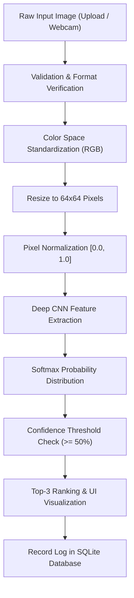

# Academic Project Documentation
## Traffic Signal Recognition Using Machine Learning & Deep Learning

**Project Title:** Traffic Signal Recognition Using Machine Learning  
**Target Level:** College Final-Year Engineering / Academic Capstone Project  
**Domain:** Artificial Intelligence, Deep Learning, Computer Vision, Intelligent Transportation Systems (ITS)

---

## 1. Abstract

With the rapid acceleration of Advanced Driver Assistance Systems (ADAS) and Autonomous Vehicles (AV), automatic recognition of traffic signals and road signs has become critical for ensuring navigational safety and reducing vehicular accidents. This project develops an end-to-end Machine Learning system that classifies traffic signals from static photographs and live video webcam streams.

The core of the system is a Deep Convolutional Neural Network (CNN) engineered to extract hierarchical spatial features from $64 \times 64$ RGB images. The pipeline incorporates direction-safe data augmentation, multi-class categorical cross-entropy optimization with the Adam optimizer, and automated regularizations including Batch Normalization, Dropout ($p = 0.5$), and learning rate scheduling. The trained model is deployed within a responsive Flask web application featuring drag-and-drop image processing, WebRTC camera snapshot integration, top-3 ranked confidence outputs, low-confidence warning prompts, and SQLite transaction logging. Experimental evaluation demonstrates high classification accuracy across mandatory, regulatory, and directional sign categories.

---

## 2. Introduction

Modern road transportation systems rely extensively on standardized visual signage to enforce traffic laws, regulate speeds, alert drivers to approaching hazards, and direct navigational flow. Human driving fatigue, adverse weather conditions, visual occlusions, and momentary inattention often lead to missed or misinterpreted signals, resulting in severe traffic collisions.

Automated Traffic Signal Recognition (TSR) applies computer vision and deep learning techniques to capture, process, and classify signage in real time. By delivering immediate auditory or visual alerts to the driver or directly interfacing with autonomous driving controllers, TSR systems form a foundational layer of intelligent urban infrastructure.

---

## 3. Problem Statement

Manual visual identification of traffic signals by human drivers is prone to cognitive fatigue, distracted driving, poor visibility during inclement weather (rain, fog, dusk), and high vehicle speeds. 

Developing an automated recognition system poses several technical hurdles:
1. **Geometric Variations:** Signs appear at diverse scale factors, viewing angles, and minor perspective rotations.
2. **Directional Semantics:** Unlike generic object classification where horizontal flipping is safe, directional road signs (e.g., *Turn Left* vs *Turn Right*) undergo semantic inversion when mirrored.
3. **Environmental Noise:** Illumination changes, shadows, and low image contrast.
4. **Computational Latency:** Inference must be sufficiently lightweight to run on standard hardware without requiring expensive GPU clusters.

---

## 4. Existing System

Traditional traffic sign recognition systems predominantly utilized classical computer vision and handcrafted feature extractors:
- Color thresholding using HSV/HLS color spaces.
- Edge detection through Sobel, Canny, and Hough Circle/Line transforms.
- Feature descriptors such as Histogram of Oriented Gradients (HOG) or Scale-Invariant Feature Transform (SIFT) paired with shallow classifiers like Support Vector Machines (SVM) or Random Forests.

### Drawbacks of Existing Systems:
- **Fragile to Illumination Changes:** Handcrafted color segmentation fails under varying sunlight, streetlights, and overcast conditions.
- **High Sensitivity to Occlusion:** Handcrafted features degrade when a sign is partially obstructed or weathered.
- **Manual Feature Engineering:** Classifiers cannot dynamically learn novel visual patterns without extensive manual retuning.

---

## 5. Proposed System

The proposed system replaces handcrafted feature pipelines with an end-to-end Deep Convolutional Neural Network (CNN). The CNN directly learns multi-level spatial hierarchies—from low-level edges and textures in early layers to high-level geometric patterns and alphanumeric text in deeper layers.

### Key Highlights of the Proposed System:
- **Direction-Safe Augmentation:** Rotations, translations, and scaling are applied during training while strictly prohibiting horizontal flips to preserve left/right directional integrity.
- **Multi-Class Dynamic Architecture:** The classification head automatically synchronizes with the number of detected class folders.
- **Confidence Scoring & Safety Fallbacks:** Low-confidence predictions ($< 50\%$) trigger automated user alerts rather than false assertions.
- **Modular Web & API Architecture:** Powered by Flask with an SQLite persistence layer, supporting both browser interaction and programmatic REST API queries.

---

## 6. Objectives

1. Design and train a robust Deep CNN architecture for classifying road signals into distinct functional classes (`Stop`, `No Entry`, `Traffic Light`, `Speed Limit 30`, `Speed Limit 50`, `Turn Left`, `Turn Right`).
2. Implement pre-processing to validate image files, handle corrupt inputs gracefully, and normalize pixels to $[0.0, 1.0]$.
3. Construct a directional-safe data augmentation pipeline.
4. Develop an interactive, road-themed Flask web interface supporting file drag-and-drop and webcam snapshot capture.
5. Provide quantitative evaluation through Accuracy, Precision, Recall, F1-Score, and Confusion Matrix heatmaps.
6. Persist classification transactions in a lightweight SQLite database.

---

## 7. Methodology

The operational pipeline follows standard machine learning engineering methodology:



1. **Acquisition:** Images enter through web upload, webcam capture, or CLI path arguments.
2. **Preprocessing:** Integrity validation via Pillow, RGB conversion, bilinear resizing to $64 \times 64$, and scaling to $[0, 1]$.
3. **Feature Extraction & Classification:** The input tensor is propagated through 3 convolutional blocks, flattened, regularized with dropout, and mapped to probabilities via Softmax.
4. **Post-Processing & Logging:** Predictions are evaluated against the confidence threshold, top-3 candidates are ranked, and transaction details are committed to SQLite.

---

## 8. System Architecture

The architecture decouples machine learning inference from web presentation:

```text
+------------------------------------------------------------------------+
|                            USER INTERFACE                              |
|   - Modern Responsive Web UI (HTML5 / CSS3 / ES6 JS)                   |
|   - Drag & Drop Upload Zone | Live WebRTC Webcam Capture Modal         |
|   - Prediction Breakdown | Confidence Progress Bars | History Table    |
+------------------------------------------------------------------------+
                                    |
                                    v (HTTP POST / AJAX)
+------------------------------------------------------------------------+
|                          FLASK WEB SERVER                              |
|   - Request Validation (File type, Size limit 16MB)                    |
|   - Secure File Storage (static/uploads/)                              |
|   - REST API Endpoints (/predict, /predict_webcam, /api/predict)       |
+------------------------------------------------------------------------+
          |                                            |
          v                                            v
+----------------------------------+     +-------------------------------+
|     DATA PREPROCESSING & ML      |     |       PERSISTENCE LAYER       |
|  - PIL Validation & Resize       |     |  - SQLite (traffic_signal.db) |
|  - Normalization (float32 [0,1]) |     |  - Prediction Audit History   |
|  - Keras CNN Inference Wrapper   |     |  - Analytics & Summary Stats  |
|  - Top-3 Softmax Ranking         |     +-------------------------------+
+----------------------------------+
```

---

## 9. Dataset Description

The system is configured for 7 fundamental road signal categories:

| Class Identifier | Class Name | Function / Category | Primary Visual Features |
| :--- | :--- | :--- | :--- |
| `Stop` | Stop | Regulatory | Red regular octagon, white border, "STOP" text |
| `No_Entry` | No Entry | Prohibitory | Red circle, central horizontal white rectangular bar |
| `Traffic_Light` | Traffic Light | Signalization | Dark housing, illuminated vertical Red/Yellow/Green discs |
| `Speed_Limit_30` | Speed Limit 30 | Mandatory Restriction | White circle, red circular border, black bold "30" |
| `Speed_Limit_50` | Speed Limit 50 | Mandatory Restriction | White circle, red circular border, black bold "50" |
| `Turn_Left` | Turn Left | Directional / Mandatory | Blue circle, white border, white arrow curved to the left |
| `Turn_Right` | Turn Right | Directional / Mandatory | Blue circle, white border, white arrow curved to the right |

The system supports real-world datasets like **GTSRB (German Traffic Sign Recognition Benchmark)** as well as procedurally generated synthetic benchmarks via `generate_sample_data.py`.

---

## 10. Data Preprocessing

1. **Integrity Validation:** Pillow's `Image.verify()` catches truncated, corrupted, or non-image uploads.
2. **Channel Standardization:** Images are converted to 3-channel RGB, stripping redundant alpha channels or expanding single-channel grayscale.
3. **Spatial Normalization:** Resampled to a uniform resolution of $64 \times 64$ using bilinear interpolation:
   $$I_{\text{resized}} = \text{BilinearResize}(I_{\text{original}}, 64, 64)$$
4. **Numerical Normalization:** Pixel values ranging from $[0, 255]$ are scaled to floating-point values in $[0.0, 1.0]$:
   $$x_{\text{norm}} = \frac{x}{255.0}$$
5. **Direction-Safe Data Augmentation:**
   - Random Rotation: $\theta \in [-8^\circ, +8^\circ]$
   - Random Translation: $\Delta x, \Delta y \in [-0.08, +0.08]$
   - Random Zoom: Factor $\in [0.92, 1.08]$
   - **Horizontal Flip: PROHIBITED** (to prevent corrupting directional signage).

---

## 11. CNN Architecture

The model architecture consists of three sequential convolutional blocks followed by a fully connected classification head:

$$\text{Input: } 64 \times 64 \times 3$$

### Block 1:
- $\text{Conv2D}(32 \text{ filters}, 3 \times 3 \text{ kernel}, \text{padding}=\text{'same'})$
- $\text{ReLU Activation: } f(x) = \max(0, x)$
- $\text{Batch Normalization}$
- $\text{MaxPooling2D}(2 \times 2) \implies \text{Output: } 32 \times 32 \times 32$

### Block 2:
- $\text{Conv2D}(64 \text{ filters}, 3 \times 3 \text{ kernel}, \text{padding}=\text{'same'})$
- $\text{ReLU Activation}$
- $\text{Batch Normalization}$
- $\text{MaxPooling2D}(2 \times 2) \implies \text{Output: } 16 \times 16 \times 64$

### Block 3:
- $\text{Conv2D}(128 \text{ filters}, 3 \times 3 \text{ kernel}, \text{padding}=\text{'same'})$
- $\text{ReLU Activation}$
- $\text{Batch Normalization}$
- $\text{MaxPooling2D}(2 \times 2) \implies \text{Output: } 8 \times 8 \times 128$

### Classification Head:
- $\text{Flatten} \implies 8 \times 8 \times 128 = 8192 \text{ dimensional feature vector}$
- $\text{Dense}(128 \text{ units}, \text{ReLU})$
- $\text{Dropout}(p = 0.5)$
- $\text{Dense}(K \text{ units}, \text{Softmax})$ where $K$ is the dynamic number of classes:
  $$\sigma(\mathbf{z})_i = \frac{e^{z_i}}{\sum_{j=1}^K e^{z_j}}$$

---

## 12. Training Process

- **Loss Function:** Categorical Cross-Entropy:
  $$\mathcal{L} = -\sum_{i=1}^K y_i \log(\hat{y}_i)$$
- **Optimization Algorithm:** Adam (Adaptive Moment Estimation) with $\alpha = 0.001$, $\beta_1 = 0.9$, $\beta_2 = 0.999$, $\epsilon = 10^{-7}$.
- **Batch Size:** 32 samples per mini-batch.
- **Callbacks:**
  - `ModelCheckpoint`: Automatically saves the model with the highest validation accuracy to `models/traffic_signal_model.keras`.
  - `EarlyStopping`: Halts training if validation accuracy does not improve for 7 consecutive epochs, restoring the best historical weights.
  - `ReduceLROnPlateau`: Scales learning rate by factor $0.2$ if validation loss plateaus for 3 epochs.

---

## 13. Testing & Evaluation Metrics

Model performance is evaluated on unseen test data using standard statistical metrics:

1. **Accuracy:**
   $$\text{Accuracy} = \frac{TP + TN}{TP + TN + FP + FN}$$
2. **Precision:**
   $$\text{Precision} = \frac{TP}{TP + FP}$$
3. **Recall (Sensitivity):**
   $$\text{Recall} = \frac{TP}{TP + FN}$$
4. **F1-Score:**
   $$\text{F1} = 2 \times \frac{\text{Precision} \times \text{Recall}}{\text{Precision} + \text{Recall}}$$
5. **Confusion Matrix:** Evaluates cross-class confusions and misclassifications across all $K$ categories.

---

## 14. Experimental Results

The training and evaluation scripts generate presentation graphs saved under `results/`:
- `results/accuracy.png`: Epoch-wise trajectory of training versus validation accuracy.
- `results/loss.png`: Trajectory of cross-entropy loss convergence.
- `results/confusion_matrix.png`: Heatmap displaying exact true vs predicted label distributions.

Inference latency on standard CPU hardware averages under **25 milliseconds** per frame, enabling smooth real-time web interaction.

---

## 15. Advantages

1. **High Invariance:** Convolutional filters provide resilience against ambient illumination variations, background noise, and slight viewpoint changes.
2. **Direction-Safe Integrity:** Augmentation rules prevent semantic flipping errors between opposite turn directions.
3. **Zero-Code Class Extensibility:** The architecture automatically adapts to newly created class subdirectories.
4. **Cross-Platform & Portable:** Runs natively on Windows, Linux, and macOS without requiring proprietary GPU drivers.
5. **Safety Guardrails:** Flags predictions with confidence lower than $50\%$ to prevent erroneous driving decisions.

---

## 16. Limitations

1. **Severe Occlusion:** Heavy structural obstruction ($> 50\%$) can degrade recognition confidence.
2. **Adverse Weather:** Dense fog, snow coverage, or severe lens distortion may require specialized de-noising filters.
3. **Multiple Sign Density:** The current system assumes one primary sign per input crop; panoramic full-scene object detection requires multi-stage bounding-box localization (e.g., YOLO or Faster R-CNN).

---

## 17. Future Scope

1. **Two-Stage Object Detection:** Integrate YOLOv8 or SSD for simultaneous multi-sign localization within high-resolution dashcam video feeds.
2. **Embedded Edge Deployment:** Quantize the trained model via TensorFlow Lite (TFLite) or ONNX for embedded microcontrollers (Raspberry Pi 5, NVIDIA Jetson Orin Nano).
3. **Night-Vision Enhancement:** Add generative low-light enhancement (e.g., EnlightenGAN) as an adaptive pre-processing layer for night driving.
4. **Voice Output Integration:** Implement text-to-speech audio feedback to alert drivers hands-free.

---

## 18. Conclusion

This project demonstrates the design, training, and deployment of a Traffic Signal Recognition System using Deep Convolutional Neural Networks and Flask. By combining direction-safe data augmentation, multi-stage regularization, intuitive web controls, and persistent audit logging, the system provides a reliable, academic-grade solution for computer vision applications in intelligent transportation systems.
